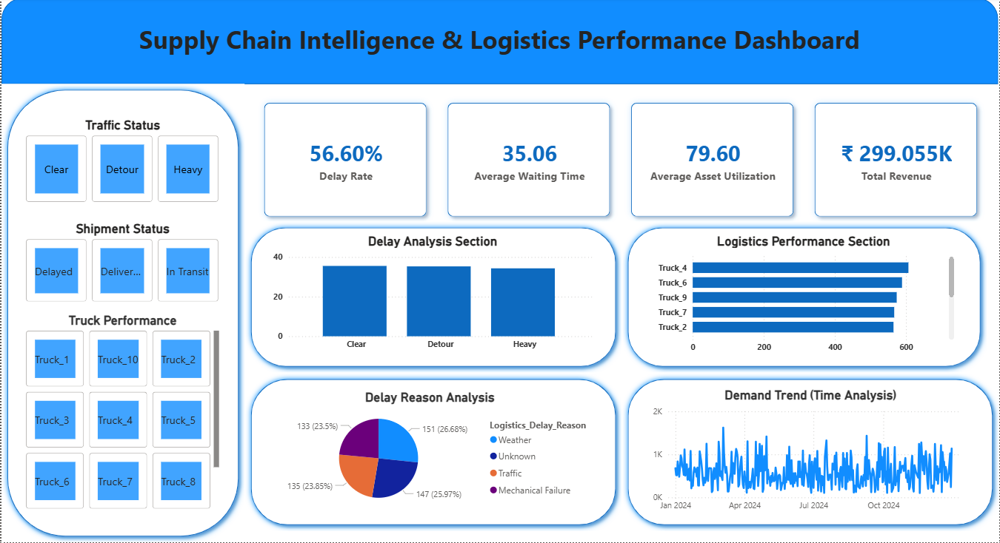

# Smart Logistics Supply Chain Analytics

## Overview
The **Smart Logistics Supply Chain Analytics** project analyzes logistics and supply chain operational data to identify inefficiencies, reduce shipment delays, and optimize asset utilization.

This project demonstrates a complete **data analytics workflow** including:

- Data Cleaning
- Exploratory Data Analysis (EDA)
- SQL-based Business Analysis
- Dashboard Visualization using Power BI

The goal is to transform raw logistics data into actionable insights that improve operational efficiency and supply chain performance.

---

## Business Problem

Logistics companies often face operational challenges such as:

- Shipment delays caused by traffic congestion
- Underutilized transportation assets
- Long waiting times during deliveries
- Difficulty forecasting demand trends
- Lack of real-time operational insights

This project analyzes logistics data to uncover patterns and improve supply chain decision-making.

---

## Project Objectives

- Analyze logistics operational data
- Identify causes of shipment delays
- Measure asset utilization efficiency
- Analyze traffic impact on waiting time
- Study demand forecasting trends
- Develop an interactive **Power BI dashboard**

---

## Tools & Technologies

| Tool | Purpose |
|-----|------|
| Python | Data Cleaning & Analysis |
| Pandas | Data Manipulation |
| NumPy | Numerical Analysis |
| Matplotlib | Data Visualization |
| Seaborn | Statistical Visualization |
| MySQL | SQL-based Data Analysis |
| Power BI | Interactive Dashboard |
| GitHub | Project Version Control |

---

## Dataset Description

The dataset contains logistics operational data including shipment performance, asset utilization, environmental conditions, and transaction information.

### Key Dataset Features

| Column | Description |
|------|-------------|
| Timestamp | Date and time of shipment |
| Asset_ID | Truck or logistics asset identifier |
| Inventory_Level | Inventory level during shipment |
| Temperature | Environmental temperature |
| Humidity | Environmental humidity |
| Waiting_Time | Time spent waiting during delivery |
| User_Transaction_Amount | Revenue generated |
| User_Purchase_Frequency | Customer purchase frequency |
| Asset_Utilization | Utilization rate of logistics asset |
| Demand_Forecast | Forecasted demand |
| Shipment_Status | Status of shipment |
| Traffic_Status | Traffic conditions |
| Logistics_Delay | Indicates if shipment was delayed |
| Logistics_Delay_Reason | Cause of shipment delay |

---

## Data Cleaning & Preprocessing

Data preprocessing was performed using **Python (Pandas)**.

Key steps included:

- Removing duplicate records
- Converting timestamp columns to datetime format
- Handling missing values
- Filling numeric values with median
- Replacing missing categorical values with "Unknown"

The cleaned dataset was exported for further analysis.

---

## Feature Engineering

Additional features were created to improve analytical insights.

### Waiting Category
- High Waiting (>30 minutes)
- Low Waiting (≤30 minutes)

### Transaction Level
- High Value Transactions (>500)
- Low Value Transactions (≤500)

### Month Feature
Extracted month from timestamp to analyze seasonal demand patterns.

---

## Exploratory Data Analysis (EDA)

EDA was performed to understand patterns in logistics operations.

Key analyses include:

- Waiting time distribution
- Traffic status vs waiting time
- Asset utilization comparison
- Monthly demand forecasting trends

Visualization techniques were used to detect operational inefficiencies.

---

## SQL Business Analysis

The cleaned dataset was loaded into **MySQL** for business-oriented analysis.

Examples of analysis:

- Total revenue generated
- Average waiting time
- Logistics delay rate
- Top performing assets
- Traffic impact on waiting time
- Shipment status distribution
- Delay reason analysis

---

## Power BI Dashboard

An interactive **Power BI dashboard** was created to visualize supply chain performance.

### Dashboard Insights

- Revenue analysis
- Shipment status distribution
- Asset utilization monitoring
- Traffic impact on waiting time
- Demand forecasting trends
- Delay reason analysis

### Dashboard Preview



---

## Key Business Metrics

Key performance indicators calculated:

- Total Revenue Generated
- Average Waiting Time
- Logistics Delay Rate
- Asset Utilization Efficiency
- Average Inventory Level

These KPIs help monitor logistics performance.

---

## Key Insights

From the analysis:

- Traffic congestion significantly increases waiting times
- High waiting times correlate strongly with shipment delays
- Some logistics assets generate higher revenue than others
- Demand shows seasonal variation across months
- Certain delay reasons occur more frequently

---

## Business Recommendations

### Traffic-Aware Route Planning
Use traffic data to optimize delivery routes.

### Asset Optimization
Improve utilization of underperforming trucks.

### Delay Prevention
Address frequent delay reasons through operational improvements.

### Inventory Planning
Align inventory levels with demand forecast trends.

### Predictive Logistics
Use machine learning models to predict demand and delays.

---

## Project Structure

```
smart-logistics-supply-chain-analytics
│
├── data
│   ├── smart_logistics_dataset.csv
│   │   
│   └── cleaned_logistics_data.csv
│       
│
├── scripts
│   └── smart_logistics_analysis.py
│
├── sql
│   └── analysis_queries.sql
│
├── dashboard
│   └── Supply_Chain_Logistics_Performance_Dashboard.pbix
│            
│
├── reports
│   └── Smart_Logistics_Project_Report.pdf
│
│
└── README.md
```

---

## Future Improvements

Potential enhancements:

- Machine learning models for delay prediction
- Demand forecasting models
- Real-time logistics analytics
- AI-based route optimization
- Cloud deployment of analytics pipeline

---

## Conclusion

The **Smart Logistics Supply Chain Analytics** project demonstrates how data analytics can improve logistics operations and supply chain performance.

By combining **Python, SQL, and Power BI**, the project provides a complete end-to-end analytics workflow for identifying operational inefficiencies and supporting data-driven decision-making.

---
